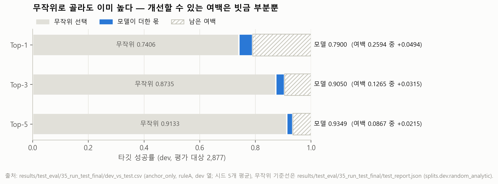
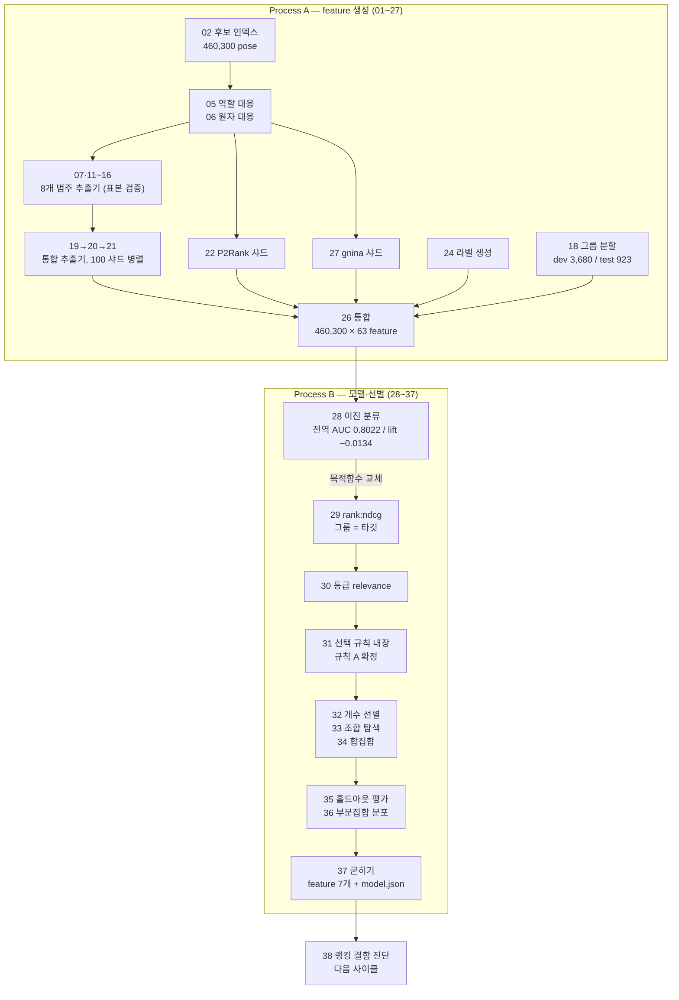
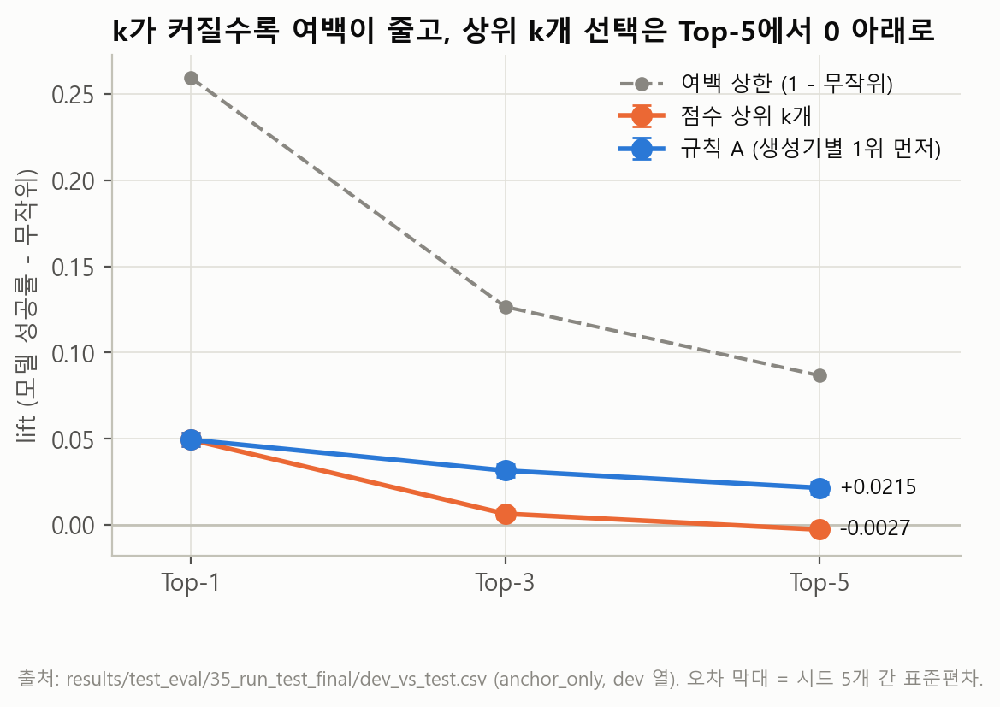
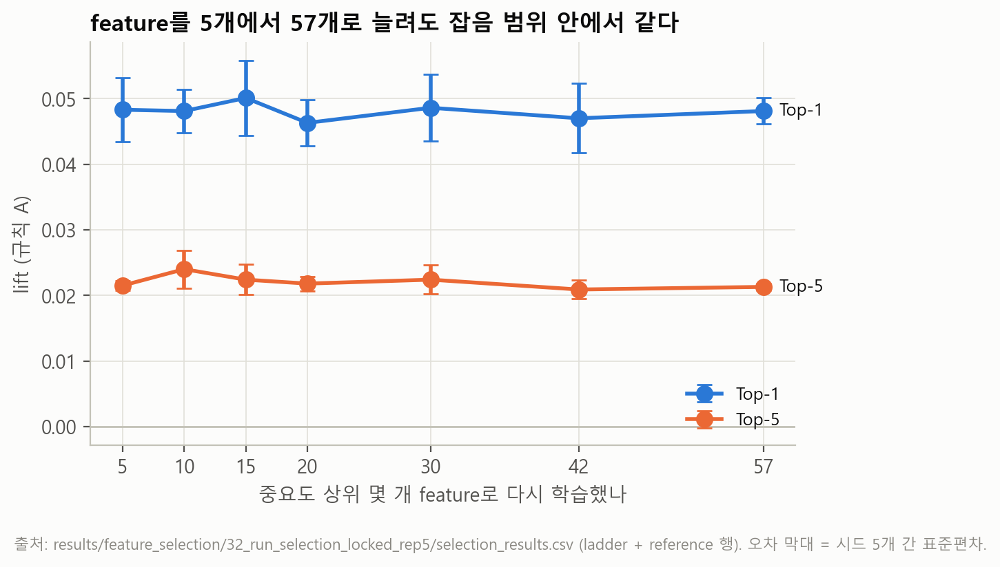
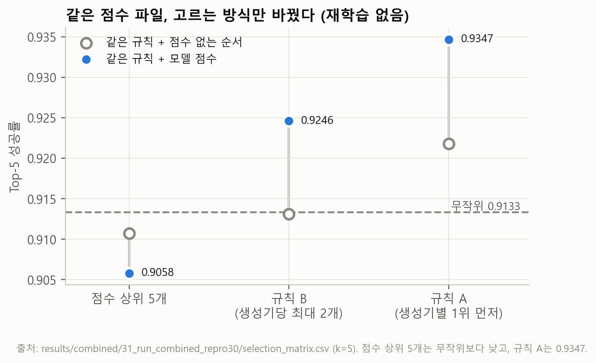
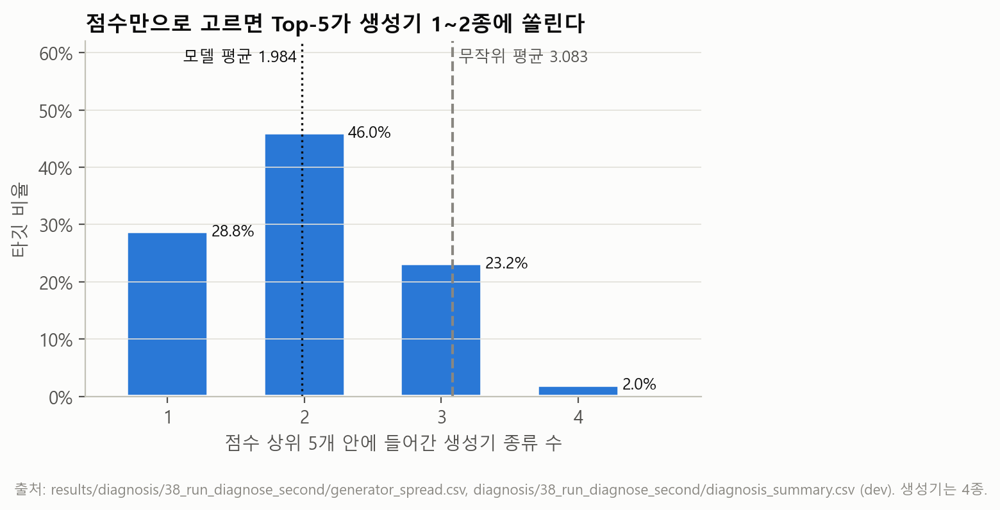

# Scoring Function

> **정답 라벨 없이, 후보 100개 가운데 제출할 Top-k를 고르는 그룹 단위 랭킹 문제.**
> `rank:ndcg`로 학습한 XGBoost 랭커와, 학습하지 않는 다양성 선택 규칙을 결합한 2단 구조다.

---

## 1. 문제 정의

구조 예측 모델 4종이 타깃 하나마다 후보(pose) 100개를 만들어 둔 상태에서 출발한다.
그중 5개를 골라 제출하고, 하나라도 정답에 가까우면 성공이다. 고를 때 정답은 쓸 수 없다.
정답은 학습 라벨로만 쓰고, 추론 입력에는 들어가지 않는다(**GT-free**).

### ML 문제로 옮기면

| 이 프로젝트 | ML |
|---|---|
| 타깃(시스템) 1개 | 쿼리 1개 = 그룹 (`qid`) |
| 후보 100개 | 그 그룹의 후보 문서 100개 |
| 생성기 4종 × 시드 5 × 표본 5 | 후보의 출처 메타데이터 |
| `sc_rmsd` (정답과의 오차, 작을수록 좋음) | 관련도 라벨 |
| Top-5 안에 `sc_rmsd < 2` 가 하나 이상 | 그룹별 `hit@5` |
| feature 7개 | 문서 feature |

- **평가 단위는 문서가 아니라 그룹이다.** 그룹마다 성공/실패를 세고 비율을 보고한다.
- **라벨 분포가 그룹마다 크게 다르다.** 어떤 그룹은 100개 중 95개가 정답에 가깝고, 어떤 그룹은 3개뿐이다.
  이 비대칭이 아래 §4의 모든 함정을 만든다.

### 핵심 제약 — 무작위 기준선이 이미 높다

| k | 무작위 `hit@k` | 남은 여백 |
|---|---|---|
| 1 | 0.7406 | 0.2594 |
| 3 | 0.8735 | 0.1265 |
| **5** | **0.9133** | **0.0867** |

제출 형식이 요구하는 k=5에서는 아무렇게나 골라도 91.33%가 성공한다. **개선 가능한 폭이 8.67%p뿐이다.**
평가 대상 2,877 그룹으로 환산하면 249개가 전부다.

그래서 지표를 둘로 나눴다.

- **Top-5 = 수용 기준.** 제출 형식이 5개다. 다만 포화돼 있어 모델 간 차이를 거의 구분하지 못한다.
- **Top-1 = 주 품질 지표.** 무작위가 0.7406이라 여백이 3배다. 모델을 비교할 때 쓴다.



---

## 2. 파이프라인



**Process A**는 8개 범주 63개 feature를 460,300개 후보 전부에 채운다.
계산 불가는 0이 아니라 null로 남긴다.

| 범주 | 개수 | 범주 | 개수 |
|---|---|---|---|
| `cat1_contact` | 13 | `cat5_pocket` | 7 |
| `cat8_ligand` | 12 | `cat2_interaction` | 5 |
| `cat4_geometry` | 8 | `cat2_gnina` | 3 |
| `cat67_water_metal` | 8 | `cat3_surface` | 7 |

**Process B**는 그 표와 라벨로 모델과 feature 집합을 정한다. 최종은 feature 7개다.

### 최종 구조 (2단)

```
   [ 그룹 1개 = 후보 100개 ]
              |
  1단  XGBRanker (rank:ndcg, qid=그룹, 트리 400개)
       feature 7개 → 후보마다 점수 1개
              |
  2단  규칙 A (학습 없음, 결정적)
       생성기 4종에서 각각 1위를 먼저 뽑고, 남은 자리는 점수순
              |
         Top-5 제출
```

1단만 쓰면 Top-5에서 무작위보다 낮다. **2단이 있어야 scoring function이 성립한다.**

---

## 3. 결과 (dev out-of-fold)

평가 대상 2,877 그룹. 5-fold GroupKFold out-of-fold 점수를 시드 5개로 반복한 평균 ± 시드 간 표준편차.

| k | 무작위 | 모델 | lift | 환산 |
|---|---|---|---|---|
| 1 | 0.7406 | **0.7900** | **+0.0494 ± 0.0040** | 약 +142 그룹 |
| 3 | 0.8735 | **0.9050** | **+0.0315 ± 0.0038** | 약 +91 그룹 |
| 5 | 0.9133 | **0.9349** | **+0.0215 ± 0.0034** | 약 +62 그룹 |

**어려운 층**(무작위 `hit@5` < 0.5인 dev 207 그룹, 무작위 0.2103)에서는 Top-5 lift가 **+0.1288 ± 0.025**다.
전체 평균은 쉬운 그룹에 묻히므로 층별로 따로 본다.



---

## 4. 핵심 결과 3가지

### (a) 전역 AUC 0.80인데 Top-5 lift가 음수 — 목적함수 오지정

| 지표 | 값 |
|---|---|
| 전역 pose AUC (5-fold 평균) | **0.8022** |
| 같은 모델의 Top-5 lift | **−0.0134** |

후보 36.8만 개를 한 통에 넣고 이진 분류하면, **"어느 그룹이 쉬운가"만 맞혀도 전역 AUC가 오른다.**
그룹마다 양성 비율이 다르기 때문이다. 그룹 안에서 상수인 feature가 중요도 상위에 올라온 것이 증거였다.

→ `rank:ndcg` + `qid = 그룹`으로 교체. 같은 그룹 안에서만 비교하게 했다.
29번 절제 3회로 귀속을 확정했다(`rank_raw` −0.0044 / `rank_z` −0.0072 / `bin_z` −0.0145 — 정규화가 해로웠다).

### (b) 지표 포화 — 재학습 없이 재채점만으로 부호가 바뀜

다섯 번 연속 "무작위보다 나쁨"이 나와 목표를 바꾸려다, 그 전에 지표를 점검했다.
Top-5는 무작위가 0.9133으로 포화돼 있었다. **같은 점수 파일을 Top-1로 다시 채점하자 다섯 실행이 모두 양수였다.**
모델은 처음부터 작동하고 있었고 지표가 재지 못한 것이다.



같은 성질이 feature 개수에도 나타난다. 중요도 상위 5개와 57개가 시드 간 잡음 범위 안에서 같다.

### (c) 선택 규칙 교정 — 0.9058 → 0.9347

점수 상위 5개를 그대로 고르면 서로 닮은 후보가 뽑혀 함께 틀린다.
**같은 점수 파일, 재학습 없이 선택 방식만 바꿨다.**

| 선택 규칙 | 모델 점수 | 점수 없는 대조군 |
|---|---|---|
| 점수 상위 5개 | 0.9058 | 0.9107 |
| 규칙 B (생성기당 최대 2개) | 0.9246 | 0.9131 |
| **규칙 A (생성기별 1위 먼저)** | **0.9347** | 0.9218 |
| 무작위 기준선 | | 0.9133 |



**이득을 분해해야 한다.** 규칙 A는 층화 추출이라 모델 없이도 무작위보다 낫다.
k=5 기준 다양성 몫 **+0.0128**, 모델 몫 **+0.0101**로 대략 반반이다.
분해하지 않으면 데이터 구조가 준 이득을 모델 공로로 기록하게 된다.

쏠림은 실측으로 확인했다. 점수만으로 고르면 Top-5가 생성기 **1.984종**만 쓴다(무작위 3.083종).



---

## 5. 현재 상태와 한계

**현재 상태**: Process A·B 완료. 최종 모델은 `results/final_model/37_run_freeze_v2/`에 파일로 고정돼 있고
파이프라인 없이 `predict.py`만으로 동작한다. 다음 사이클은 38번 진단까지 끝났다.

**한계**

1. **test 923은 홀드아웃으로 소진됐다.** 마지막 1회만 쓰려 했으나 35번(집합 4종 평가), 36번(부분집합 31종),
   37번(재현 확인), 38번(메커니즘 확인)에서 열렸다. feature를 11개에서 7개로 줄인 결정에 35·36번 결과가
   영향을 줬다. 그래서 **이 레포의 주지표는 dev OOF이고, test 수치는 헤드라인으로 쓰지 않는다.**
2. **dev OOF도 선택 편향을 포함한다.** feature 집합·선택 규칙·등급 경계를 모두 dev OOF를 보고 정했다.
   실제보다 낙관적일 수 있다. 35번에서 탐색을 많이 거친 집합일수록 홀드아웃에서 더 많이 떨어지는 것을 관측했다.
3. **feature가 전부 총량이다.** "접촉이 몇 개인가"는 세지만 "무엇과 접촉하는가"는 보지 않는다.
   어느 잔기와 어떤 유형의 상호작용인지를 담은 feature가 없다. feature 선별로는 해결되지 않고 새로 만들어야 한다.
4. **남은 실패의 2/3은 선택으로 못 푼다.** 38번 진단 결과, 규칙 A 실패 그룹에서 정답이 20위 밖인 경우가
   76/176이다. 이건 점수 자체(그룹 내부 AUC 0.6573)를 개선해야 한다.
5. **외부 도구 의존.** feature 7개 중 4개가 gnina(3)와 P2Rank(1)의 출력이다.
   처음부터 만든 점수 함수가 아니라 **그 도구들 위에 올린 재순위화기**다.
6. 추론 비용의 대부분이 feature 추출이다. gnina가 후보당 약 5초(8코어)다.

---

## 6. 디렉터리와 재현

```
README.md
docs/
  DEVLOG.md             날짜별 [한 일 / 문제 / 판단과 이유 / 결과]
  SCRIPTS.md            번호별 역할·입출력 표와 의존 관계
  LESSONS.md            방법론 교훈과 실제 사례
  AI_COLLABORATION.md   역할 분담과 검증 방법
  ANONYMIZATION.md      경로 치환 규칙과 파일별 변경 내역
pipeline/               스크립트 81개 (번호 유지, 한 폴더)
  ORIGINAL_SHA256SUMS.txt   치환 전 원본 해시
results/                요약 CSV·JSON과 최종 모델
figures/                그림 5장 + make_figures.py
tools/                  서버 결과 수집 스크립트
```

`pipeline/`을 Process A·B 폴더로 나누지 않았다. 스크립트가 `Path(__file__).with_name(...)`으로
**같은 폴더의 형제 파일을 import**하기 때문이다(38 → 36 → … → 28 → 05). 구분은 `docs/SCRIPTS.md`의 표에 있다.

### 환경

Linux GPU 서버, SLURM 작업 제출. Python + XGBoost 2.1.4, gemmi, RDKit, NumPy, SciPy, pandas, PyArrow,
scikit-learn. 외부 도구 gnina, P2Rank. XGBoost 외 버전은 `확인 필요`.

**XGBoost는 일부러 CPU로 학습했다.** 모든 판정이 시드 간 표준편차를 측정 잡음으로 쓰는데,
GPU 히스토그램 집계는 같은 시드에서도 마지막 자리가 흔들려 그 전제를 깬다.
서로 다른 시점에 학습한 `model.json`이 바이트 단위로 같은 것을 확인했다.

### 그림 다시 그리기

```bash
python figures/make_figures.py
```

`results/`의 파일만 읽는다. 새 계산은 하지 않는다.

### 추론

학습된 모델은 독립 실행된다. 파이프라인 스크립트가 필요 없다.

```bash
python results/final_model/37_run_freeze_v2/predict.py --poses poses.parquet --k 5 --out top5.csv
```

필요한 열은 `system_id`, `model`(생성기), `pose_id`와 feature 7개다.
**결측은 빈 값으로 둔다.** 0으로 채우면 틀린 점수가 나온다(학습 때 NaN을 NaN으로 다뤘다).

### 파이프라인 실행

서버 경로가 자리표시자로 치환돼 있다. 자기 환경 경로로 되돌려야 한다.

```bash
sed -i -e 's#<DATA_ROOT>#/path/to/workspace#g' -e 's#<SHARED_ROOT>#/path/to/shared#g' pipeline/*.py pipeline/*.sh
```

---

## 7. 수치 출처

README의 모든 수치는 `results/` 파일에서 읽은 값이다. 대조 결과는 `docs/NUMBERS.md`에 있다.

| 수치 | 파일 | 위치 |
|---|---|---|
| 무작위 0.7406 / 0.8735 / 0.9133 | `test_eval/35_run_test_final/test_report.json` | `splits.dev.random_analytic` |
| 모델 0.7900 / 0.9050 / 0.9349, lift ±σ | `test_eval/35_run_test_final/dev_vs_test.csv` | `anchor_only` 행, `dev\|mean\|…\|ruleA\|k*` |
| 어려운 층 +0.1288 ± 0.025 | 같은 파일 | `dev\|mean\|hard_lift\|ruleA\|k5` |
| 어려운 층 207 그룹, 무작위 0.2103 | `test_eval/35_run_test_final/strata_profile.csv`, `test_report.json` | dev 행 합, `splits.dev.random_analytic_hard` |
| 전역 AUC 0.8022, lift −0.0134 | `baseline/28_run_baseline_f63/baseline_report.json` | `mean_auc`, `lift` |
| 29번 절제 −0.0044 / −0.0072 / −0.0145 | `ranking/29_run_ranking_*/ranking_report.json` | `lift` |
| 선택 규칙 0.9058 / 0.9246 / 0.9347, 대조군 | `combined/31_run_combined_repro30/selection_matrix.csv` | `topk=5` |
| 다양성 +0.0128 / 모델 +0.0101 | `combined/31_run_combined_repro30/contribution.csv` | `ruleA`, `topk=5` |
| 460,300 pose / 4,603 그룹 / 63 feature | `feature_matrix_all/26_run_integrate_all_final/` | `integration_report.json`, `feature_catalog.csv` |
| dev 3,680 / test 923 / 5-fold | `data_split/18_run_make_split/split_report.json` | `dev_systems`, `test_systems`, `folds` |
| 평가 대상 3,595 | `eval/25_run_evaluate/eval_report.json` | `category_counts` |
| 생성기 1.984 vs 3.083, AUC 0.6573 | `diagnosis/38_run_diagnose_second/diagnosis_summary.csv` | `generator_spread`, `score_signal` |
| 20위 밖 76/176 | `diagnosis/38_run_diagnose_second/` | (시스템 단위 표는 비공개 — `results/README.md` 참조) |
| 학습 그룹 2,482 / 후보 243,599 | `final_model/37_run_freeze_v2/provenance.json` | `models[0]` |

---

## 8. 문서

| 문서 | 내용 |
|---|---|
| [DEVLOG](docs/DEVLOG.md) | 날짜별 진행. 결론이 네 번 뒤집힌 과정 |
| [SCRIPTS](docs/SCRIPTS.md) | 스크립트 81개 역할·입출력·의존 관계 |
| [LESSONS](docs/LESSONS.md) | 방법론 교훈과 실제 사례 |
| [AI_COLLABORATION](docs/AI_COLLABORATION.md) | 역할 분담과 AI 출력 검증 방법 |
| [NUMBERS](docs/NUMBERS.md) | README 수치 ↔ 결과 파일 자동 대조 |
| [results/README](results/README.md) | 결과 파일별 출처와 해시 대조 |

**라이선스**: 코드 MIT([LICENSE](LICENSE)). 데이터 출처는 [DATA.md](DATA.md).
