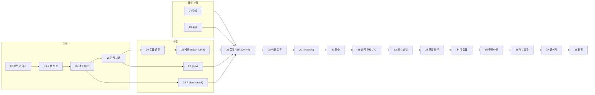

# SCRIPTS

Python 39개 + SLURM 러너 42개 = 81개. 번호는 작성 순서이고 대체로 실행 순서와 같다.

## 공통 규칙

- **번호 하나 = 단계 하나.** `NN_이름.py`가 본체, `NN_run_*.sh`가 러너다. 01·99번은 러너 없이 직접 실행했다.
- **출력**: `out/<작업종류>/<러너 이름>/`. `--tag`로 실행을 나누고 기존 폴더는 덮어쓰지 않는다(`FileExistsError`).
- **완료 표식**: 모든 출력 폴더에 `RUN_COMPLETE.json`과 `*_report.json`. 보고서에 실행 범위·입력 해시·
  스크립트 해시(`script_sha256`)·한계를 적는다.
- **모듈 재사용**: 뒤 번호가 앞 번호를 `importlib`로 불러 쓴다. 같은 계산을 두 번 구현하지 않기 위해서다.
- **러너는 `--mem`을 지정하지 않는다.** 이 클러스터에서 메모리 요청이 거부됐다.

## 의존 관계



**Process B는 import 사슬이다.** 뒤 번호가 앞 번호의 함수를 그대로 쓴다.

```
38 → 36 → 35 → 34 → 33 → 32 → 31 → 30 → 29 → 28 → 05(경로 보호·저장 helper)
```

import 경로가 `Path(__file__).with_name(...)`, 즉 **같은 폴더**다. 그래서 `pipeline/`을 하위 폴더로 나누지 않았다.
나누면 B단계가 A단계 helper를 찾지 못한다.

---

## Process A — feature 생성 (01~27, 99)

| # | 역할 | 입력 | 출력 | 상태 |
|---|---|---|---|---|
| 01 | 구조 4개 파일럿 | 구조 4개 | `features.parquet` | 폐기 → 07 |
| 02 | 후보 460,300개 식별자 ↔ 파일 목록 | 시스템 목록, manifest | `pose_index.parquet` | 현역 |
| 03 | 검증용 표본 40 그룹(160 후보) 선정 | 02 | `selected_systems.csv` | 현역 |
| 04 | 선정 구조 표현 점검(읽기 전용) | 구조 파일 | 감사 CSV | 현역 |
| 05 | 역할 대응 — 어느 체인이 무엇인가 | 생성 입력, 구조 | `selected_atom_sets.jsonl` | **현역·핵심** |
| 06 | 원자 대응 — 그래프 동형 매칭 | 05, SMILES | `ligand_atom_mapping.jsonl` | **현역·핵심** |
| 07 | cat1 접촉·거리(표본) | 05, 06 | `contact_features.parquet` | 폐기 → 19/20/21 |
| 08 | cat1을 약 4,000 후보로 확대 | 02, 03 | `contact_features.parquet` | 폐기 → 19/20/21 |
| 09 | cat1 ↔ 라벨 관계 탐색 | 08, 평가 CSV | `feature_ranking.csv` | 역할 종료 |
| 10 | 같은 탐색을 난이도 층별로 | 08, 평가 CSV | `system_difficulty.csv` | 역할 종료 |
| 11 | cat3 표면·매몰 (SASA 직접 구현) | 05 | `surface_features.parquet` | 폐기 → 19/20/21 |
| 12 | cat8 리간드 descriptor | SMILES | `ligand_descriptors.parquet` | 폐기 → 19/20/21 |
| 13 | cat6 물 / cat7 금속 | 05 | `water_metal_features.parquet` | 폐기 → 19/20/21 |
| 14 | cat5 포켓(P2Rank) | 05, P2Rank | `pocket_features.parquet` | 폐기 → 22 |
| 15 | cat4 리간드 내부 기하 | 06 | `ligand_geometry.parquet` | 폐기 → 19/20/21 |
| 16 | cat2 상호작용·반발 | 06 | `interaction_features.parquet` | 폐기 → 19/20/21 |
| 17 | 8개 범주 표본 통합 | 07·11~16 | `unified_features.parquet` | 폐기 → 26 |
| 18 | 누수 방지 분할 + CV 폴드 | 시스템 메타데이터 | `system_split.csv` | **현역·핵심** |
| 19 | 통합 단일 패스 추출기 + 표본 검증 | 05, 06 | `combined_features.parquet`, `validation.csv` | 폐기 → 20 |
| 20 | 자립형 통합 엔진 + 비용 측정 | 02, 03, 05 | `combined_features.parquet` | 현역(21의 엔진) |
| 21 | cat1~4·6~8 샤드 추출·재개·병합 | 02, 05 | `combined_features_all.parquet` | 현역 |
| 22 | cat5 샤드(후보 단위 체크포인트) | 02, 05, P2Rank | `pocket_features_all.parquet` | 현역 |
| 23 | gnina 두 모드 smoke test | 05, 06, gnina | `gnina_smoke.parquet` | 역할 종료 → 27 |
| 24 | 460,300행 라벨 표 | 평가 CSV, 02 | `labels.parquet` | **현역·핵심** |
| 25 | Top-K 평가 하네스 | 24, 18, (점수) | `eval_report.json` | 역할 종료 ※ |
| 26 | 세 갈래 feature + 라벨 + 분할 통합 | 21, 22, 27, 24, 18 | `unified_all.parquet`, `feature_catalog.csv` | **현역·핵심** |
| 27 | gnina 전량 추출(`score_only`) | 02, 05, gnina | `gnina_features_all.parquet` | 현역 |
| 99 | 21번 정지 원인 조회(읽기 전용) | 02, 05 | 화면 출력만 | 역할 종료 |

## Process B — 모델·선별 (28~37)

입력은 전부 26번의 `unified_all.parquet`이다.

| # | 역할 | 추가 입력 | 핵심 출력 | 결말 |
|---|---|---|---|---|
| 28 | 이진 분류 베이스라인 | — | `baseline_report.json` | 전역 AUC 함정 발견 |
| 29 | `rank:ndcg`(그룹=타깃) + 절제 3회 | — | `ranking_report.json` | 정규화가 해로움을 확정 |
| 30 | 5단계 등급 relevance | 29 결과 | `graded_report.json` | 학습 가능 그룹 1,743 → 2,482 |
| 31 | 선택 규칙 내장 + 표현×경계 2×2 | — | `selection_matrix.csv`, `contribution.csv` | 규칙 A 확정 |
| 32 | 개수 선별(중요도 사다리, 시드 5회) | `feature_catalog.csv` | `chosen_features.json`, `selection_results.csv` | 상위 10개 (후에 기각) |
| 33 | 조합 탐색(2 전수 + 3~6 beam) | 32 | `ranked_combinations.csv`, `replacement_verdict.json` | 11개 채택 |
| 34 | 합집합 비교 | 32, 33 | `final_feature_set.json`, `union_results.csv` | 11개 유지 |
| 35 | 홀드아웃 1회 평가(집합 4종) | 34, 32 | `dev_vs_test.csv`, `contribution.csv` | 조합 기여 재현 실패 |
| 36 | 부분집합 분포·전이 상관 | 34, 35 | `distribution.csv`, `transfer.csv` | 7개 위 추가 무의미 |
| 37 | 굳히기 | 34, 35 | `model.json`, `spec.json`, `provenance.json`, `predict.py` | **feature 7개 확정** |

**35·36·37이 읽는 앞 단계 결과** (코드와 보고서 기록이 일치함을 확인함)

- 35: `34_run_union_final_full/union_results.csv`에서 집합 4종을 읽는다. 같은 폴더의 `final_feature_set.json`,
  `32_run_selection_locked_rep5/chosen_features.json`과 대조해 다르면 멈춘다.
- 36: 같은 34 폴더에서 지정 집합을, 이미 잰 4종은 `35_run_test_final`에서 읽는다.
- 37: 34 폴더의 `anchor_only`(7개)와 35번 수치를 재현 기준으로 쓴다.

## 다음 사이클

| # | 역할 | 입력 | 출력 | 상태 |
|---|---|---|---|---|
| 38 | 랭킹 결함 진단 | 26, 37 `model.json` | `diagnosis_report.json`, `success_curve.csv` | `first`·`second` 완료 → 39(후보 간 거리 추출)로 분기 |

---

## 폐기된 스크립트와 그 이유

폐기는 전부 **"뒤 번호가 같은 일을 더 잘하게 됐다"**이고, 잘못 만들어서가 아니다.
모두 자기 단계에서 검증을 마친 뒤 역할을 넘겼다.

| 스크립트 | 폐기 이유 |
|---|---|
| **01** → 07 | 구조 4개 전용 파일럿. 파일 목록도 역할 대응도 없이 경로를 직접 받는다. 07이 같은 계산을 표본 전체로 일반화했다. 01과 07의 값이 비트 단위로 일치함을 확인한 뒤 넘겼다 |
| **07·11·12·13·15·16** → 19/20/21 | 범주마다 구조 파일을 따로 읽어 같은 파일을 7번 읽는다. 19가 후보당 1회 읽기로 합쳤다. **표본에서 전 값 대조 불일치 0건**을 확인하고 넘겼다 |
| **08** → 19/20/21 | 목적이 feature 생산이 아니라 **추출 안정성 측정**이었다(시간·메모리·실패율). 460k 확대의 비용을 추정하는 역할을 다했다 |
| **14** → 22 | P2Rank가 외부 Java 바이너리라 비용이 크다. 22가 후보 단위 체크포인트를 추가해 중단 지점부터 재개할 수 있게 했다 |
| **17** → 26 | 표본 160 후보용 통합. 26이 같은 join을 460,300 후보에 적용하고 라벨·분할까지 결합한다 |
| **19** → 20 | 저장해 둔 역할·원자 대응을 **읽어서** 쓴다. 따라서 표본 밖 후보는 처리할 수 없다. 20이 대응을 직접 계산하는 자립형으로 바꿔 임의 후보를 처리한다. 19는 "합쳐도 값이 같은가"를 검증하는 역할을 다했다 |
| **23** → 27 | 두 모드 변별력·플래그·파싱·비용을 확정하는 smoke test. 27이 승자 모드로 전량 실행한다 |
| **09·10** | 표본 기반 탐색. 학습·분할·정규화 없이 "단일 feature가 무작위를 이기는가"만 봤고 **못 이긴다**는 답을 얻었다. 그 답이 Process B 전체의 출발점이 됐다 |
| **99** | 21번 정지 원인을 역산하기 위해 만든 일회성 조회 도구. 읽기 전용이고 아무 파일도 쓰지 않는다. 원인 규명 후 역할 종료 |
| **25** ※ | 아래 참조 |

### ※ 25번은 폐기가 아니라 "부분적으로만 쓰였다"

25번은 어떤 점수든 채점하는 **재사용 하네스**로 만들었다. 실제로는 **모델 점수 없이 기준선만 계산하는 데
1회** 실행됐다(`RUN_COMPLETE.json`의 `has_scores: false`).

28번부터는 32번에 정의된 평가 함수를 각자 import해 쓰고, **25번을 호출하는 스크립트는 없다.**
이 실행에서 나온 분류(평가 대상 3,595 / 근접 후보 0개 450 / 라벨 전무 558)와
무작위 기준선 0.9133이 이후 모든 lift의 분모가 됐으므로, 산출물 자체는 현역이다.

> 되돌아보면 평가 함수를 25번 하나로 모으고 28~38이 그것을 import했어야 했다.
> 실제로는 평가 로직이 32번에 생겨 사슬로 전파됐다. 결과가 갈라지지는 않았지만(한 곳에 정의돼 있으므로)
> 하네스를 먼저 만든 의도는 살리지 못했다.

---

## 경로

서버 경로는 자리표시자로 치환돼 있다([ANONYMIZATION.md](ANONYMIZATION.md)).
치환 전 원본 해시는 [`../pipeline/ORIGINAL_SHA256SUMS.txt`](../pipeline/ORIGINAL_SHA256SUMS.txt)에 있고,
결과 보고서의 `script_sha256`과 대조할 수 있다.
